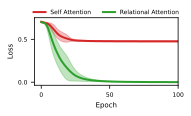
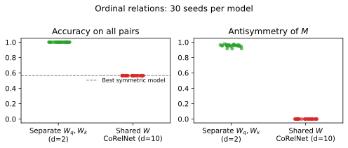
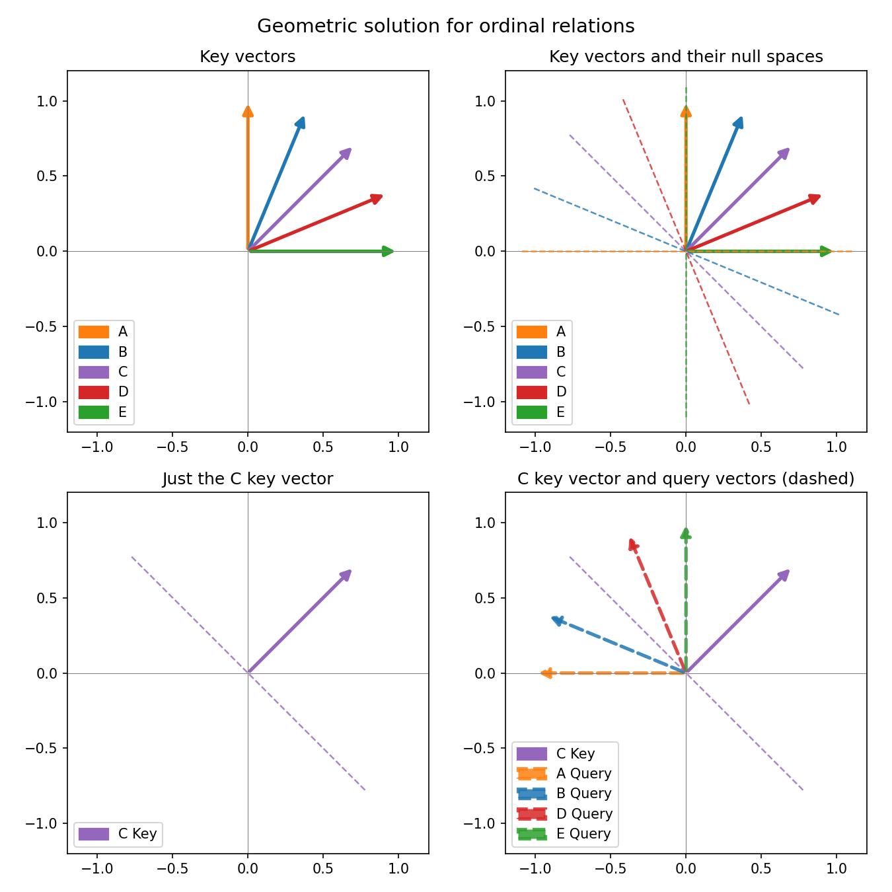
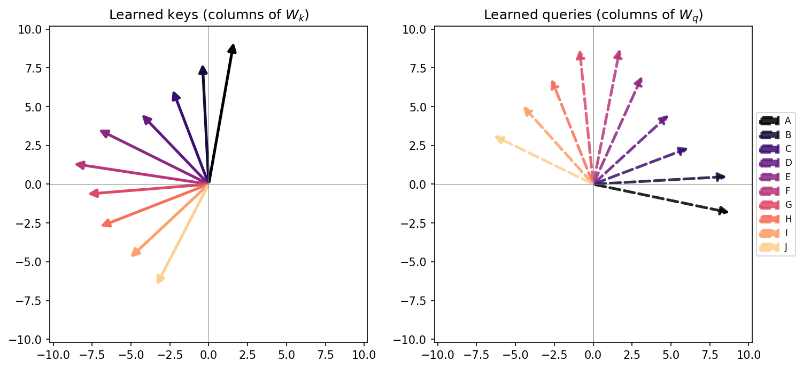

# Relational attention

Small, fully interpretable attention models on two classic relational problems:

1. **XOR.** A *relational bottleneck* (attention whose values don't depend on the input) lets a single softmax attention head solve XOR, which standard softmax self-attention can't.
2. **Ordinal relations.** Telling whether $x_1 < x_2$ requires an **asymmetric** query-key interaction. Models that tie queries to keys, such as CoRelNet, provably can't do better than chance, however large they are.
3. **A geometric solution.** A 2-dimensional attention head solves ordinal relations by placing keys on an arc in rank order and making each query its key rotated by 90°. When trained on all pairs, gradient descent finds this solution on its own.

Every experiment runs in seconds to minutes on a laptop CPU.

## Models

A standard self-attention head computes values from its input. A **relational attention head** uses a learned value matrix $V$ that is the same for every input:

$$
\text{SelfAttention}(X) = \sigma\!\left(\tfrac{XW_q (XW_k)^\top}{\sqrt{d}}\right) XW_v
\qquad
\text{RelationalAttention}(X) = \sigma\!\left(\tfrac{XW_q (XW_k)^\top}{\sqrt{d}}\right) V
$$

Here $\sigma$ is a row-wise softmax, or the identity for the *linear* variants. Since $V$ is fixed, the only information that reaches the classifier is the attention pattern, i.e. how the tokens relate to each other, not which tokens they are.

For ordinal relations we use the smallest possible attention-style model: a single query-key score $s(x_1, x_2) = (W_q x_2)^\top (W_k x_1) / \sqrt{d} = x_1^\top M x_2 / \sqrt{d}$, with $M = W_k^\top W_q$.

## Results

### 1. The relational bottleneck solves XOR

Two one-hot tokens in $\mathbb{R}^2$ are labelled 1 if they differ. Over 30 random initializations, softmax self-attention gets stuck at a loss of about 0.48 every time, while relational attention reaches zero loss every time. The relational head's solution is easy to read: when the tokens are the same, both attend uniformly; when they differ, each token attends entirely to the other.



| Attention head | Seeds solved (loss < 0.05) |
|---|---|
| Self attention (softmax) | 0 / 30 |
| Relational attention (softmax) | 30 / 30 |
| Linear self attention | 30 / 30 |
| Linear relational attention | 30 / 30 |

Removing the softmax also fixes self-attention on this task, so the relational bottleneck is *a* fix for softmax attention, not the only one.

### 2. Ordinal relations need asymmetric query-key interactions

Items have a hidden order $A < B < C < \dots$; given a pair, output 1 if the first item comes before the second. With one-hot inputs, the logit for (item $i$, item $j$) is simply $M_{ij}$. Split $M$ into a symmetric part $S$ and an antisymmetric part $A$. A pair $(i, j)$ and its reversal $(j, i)$ always have opposite labels, but $S$ gives them the same logit. Only $A$, for which $A_{ij} = -A_{ji}$, can tell them apart.

If queries and keys share a single matrix ($W_q = W_k = W$, as in CoRelNet), then $M = W^\top W$ is symmetric and $A = 0$. Such a model can do no better than guessing the more frequent direction of each pair, whatever its size. We train on **all** pairs of 10 items, so this tests what each model can represent, not how it generalizes. Over 30 seeds:

- Separate $W_q, W_k$ with a **2**-dimensional head reaches 100% accuracy every time, and its learned $M$ is almost entirely antisymmetric.
- CoRelNet with a **10**-dimensional head reaches 56.3–56.5% accuracy every time. That matches the best possible accuracy for a symmetric model on this training set (56.5%), and its $A$ is exactly 0.



### 3. A geometric solution

The simplest antisymmetric solution fits in two dimensions:

1. Put each item's key on a unit arc, with angle decreasing by rank and the whole arc spanning less than 180°.
2. Make each item's query its key rotated by 90°.

The score for the pair $(i, j)$ is then $q_j \cdot k_i = \cos(\theta_j + 90^\circ - \theta_i) = \sin(\theta_i - \theta_j)$, which is positive exactly when $i$ comes before $j$. This holds for every pair, adjacent or not. Geometrically, each key's null space separates the queries of lower-ranked items from those of higher-ranked items.



A trained 2-dimensional head finds this construction up to a reflection. In 10 out of 10 seeds, the learned keys spread out in rank order over 162–166°, and every query is its key rotated by 90° ± 4°.



## Repository layout

```
src/relational_attention/
    models.py      SelfAttentionHead, RelationalAttentionHead, AttentionClassifier,
                   QueryKeyScorer, CoRelNet
    tasks.py       XORDataset, OrdinalRelationsDataset
    training.py    train_model, evaluate_model
notebooks/
    01_xor_relational_bottleneck.ipynb
    02_ordinal_relations_need_asymmetry.ipynb
    03_ordinal_relations_geometric_solution.ipynb
scripts/
    xor_batch.py                   30-seed XOR run      -> data/xor_results.csv
    ordinal_relations_batch.py     30-seed ordinal run  -> data/ordinal_relations_results.csv
docs/ordinal_relations/            LaTeX figure describing the ordinal relations task
```

## Reproducing

This project uses [uv](https://docs.astral.sh/uv/) and Python 3.13.

```bash
uv sync

# Batch experiments (run from the repo root; each takes several minutes on CPU)
uv run python scripts/xor_batch.py
uv run python scripts/ordinal_relations_batch.py

# Notebooks (they read the batch results from data/ and write figures to results/)
uv run jupyter lab notebooks/
```

## Background

This project began as an exploration of inductive biases for symbolic processing in attention. It also included experiments on whether models trained only on adjacent pairs (B < C, C < D, ...) generalize to non-adjacent pairs (transitive inference), and on biasing training toward the geometric solution above. Those results were inconclusive and are not part of this repository; they are preserved in the git history under the tag `archive/symbolic-inductive-biases`.

## License

MIT
